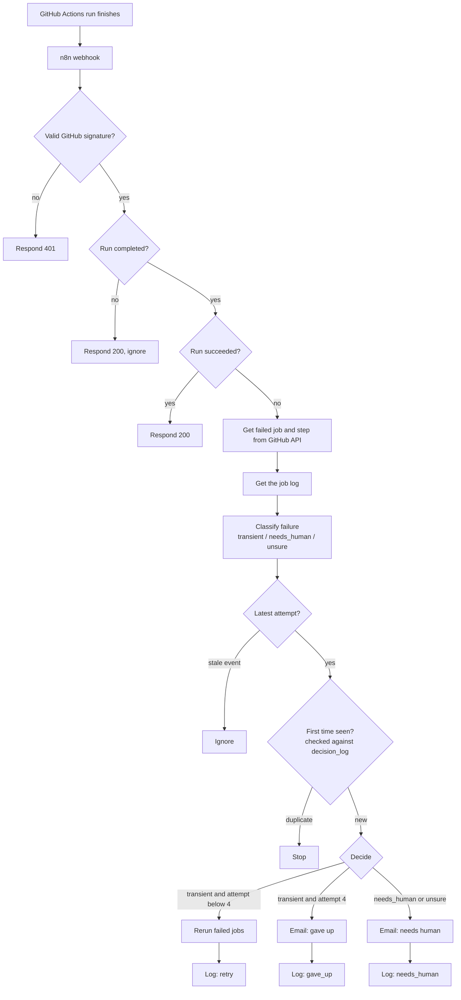

# workflow-reliability-lab

An n8n workflow that watches GitHub Actions runs, works out why a run failed, retries it automatically if the failure looks temporary, and emails a person if it doesn't.

## The problem
When a CI run fails, it is usually one of two things:

- a **temporary problem** (a network drop, a timeout, a rate limit), where simply running it again fixes it, or
- a **real bug** (a failing test, a missing file), where running it again wastes time.

This workflow tells them apart. It retries only the temporary kind, at most 3 times, and sends everything else to a human.

## How it works

## What was built
- **Secure receiver:** an n8n webhook with Raw Body enabled. n8n calculates an HMAC-SHA256 of the raw request body and compares it with GitHub's `X-Hub-Signature-256` header. Invalid requests get a 401.
- **Filters:** only finished runs are processed, and successful runs are acknowledged and left alone.
- **Investigation:** HTTP Request nodes call the GitHub API (using a fine-grained token limited to this repository) to get the failed job, the failed step and the log text.
- **Classifier:** simple, readable rules look for words in the log. Bug words (`AssertionError`, `SyntaxError`, "No such file", "Permission denied" and so on) are checked first. Temporary words (`ETIMEDOUT`, "connection reset", "timed out", "503", "429", "rate limit") come second. Anything else is `unsure` and goes to a human.
- **Bounded retry:** a Switch node reruns the failed jobs only for temporary failures with an attempt number below 4. That is the original run plus 3 reruns. The attempt number is read from the event itself.
- **Human escalation:** two Gmail emails, `[Needs human]` and `[Gave up]`, each with the repo, failed step, attempt and a link to the job.
- **Safety and traceability:**
  - ignore events about an attempt that is no longer the latest;
  - skip a run and attempt that is already in the log;
  - write every decision to an n8n data table, `decision_log` (repo, run ID, attempt, category, decision).

## How it was tested
Three deliberate GitHub Actions workflows in this repo, each started by hand:

| Test | What it does | Result |
|---|---|---|
| Test - Real bug | fails with a test assertion | 1 attempt, no retry, 1 `[Needs human]` email |
| Test - Always timeout | fails with a timeout every time | 4 attempts, 3 reruns, then 1 `[Gave up]` email |
| Test - Flaky then fine | fails twice with a network error, then passes | 2 reruns, passes on attempt 3, no email |

Each run was checked against the GitHub run page, the n8n executions and the `decision_log` rows.

## Stack
n8n Cloud (Webhook, Crypto, If, Switch, Edit Fields, HTTP Request, Gmail and Data table nodes), GitHub Actions, GitHub REST API.
